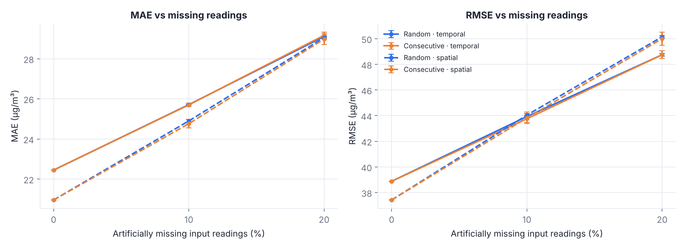
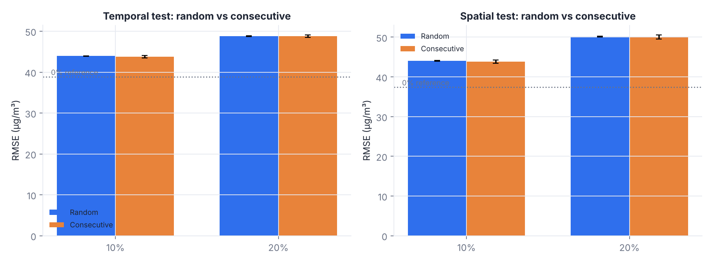
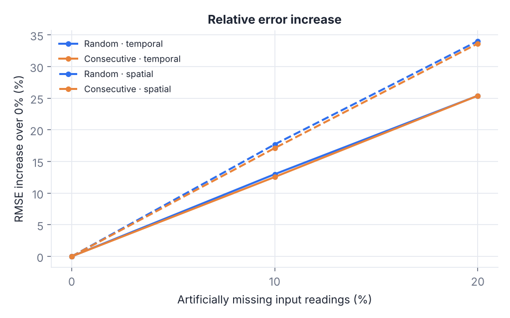
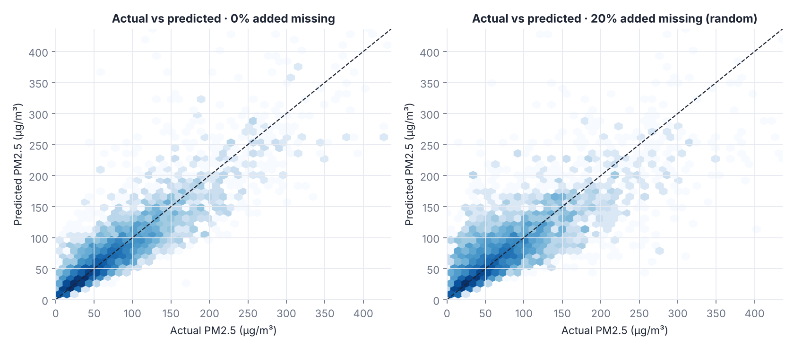
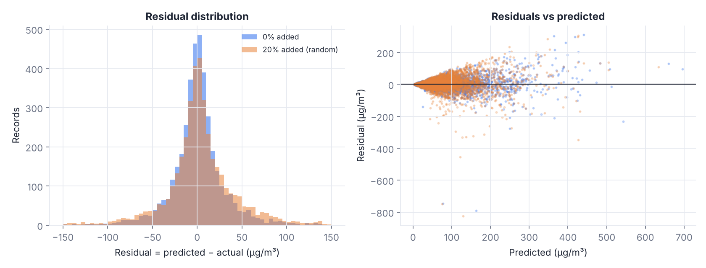
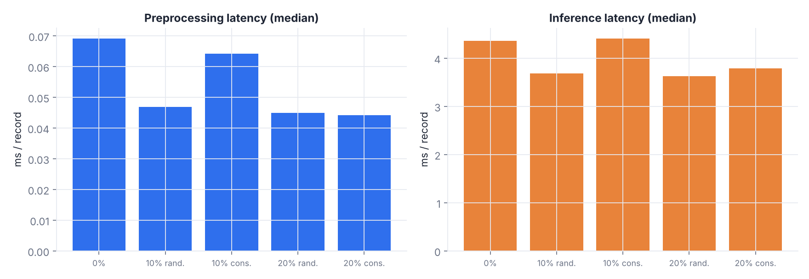

# Edge-Based Air Quality Prediction Under Incomplete IoT Sensor Data — Experimental Report

## Abstract

This report evaluates how the amount and pattern of missing IoT sensor readings affect the accuracy and local processing latency of a lightweight edge-style PM2.5 estimator. A random forest leaf10 model was trained on 141 CPCB monitoring stations (3,310,820 station-hour records, 2011-05-02 to 2023-03-31) and evaluated on a frozen benchmark with 0%, 10% and 20% of input readings removed at random or in consecutive blocks (10 seeded trials per scenario). On the temporal test set RMSE moved from 38.88 µg/m³ with no added gaps to 43.93 at 10% and 48.75 at 20% (random pattern). On the spatial test set RMSE moved from 37.42 µg/m³ with no added gaps to 44.04 at 10% and 50.15 at 20% (random pattern). Edge behaviour is a software simulation on a general-purpose computer; no physical edge hardware was used.

## 1. Research question and scope

How do the amount and pattern of missing IoT sensor readings affect prediction accuracy, robustness and local processing latency of a lightweight edge-based PM2.5 prediction pipeline? The study is an experimental evaluation of an existing approach (median imputation followed by a tree-ensemble regressor), not a new algorithm. The task is same-hour estimation of PM2.5 from twelve co-located readings (PM10, NO, NO2, NOx, SO2, CO, O3, RH, WS, WD, SR, AT); it is not forecasting and no lagged or future values are used.

## 2. Data source and a change from the original proposal

The original report named the UCI Air Quality dataset. The experiments in this report use the station-wise hourly CPCB (Central Pollution Control Board, India) records distributed on Kaggle instead; the project owner approved this substitution. The two sources differ in geography, sensors, period, station count and missingness, so numbers from the earlier report are not comparable with the results here.

The original report also stated that incomplete records would be removed. This study deliberately keeps records with some missing inputs, because incomplete inputs are the subject of the research; only records with no valid PM2.5 target, with an unparseable timestamp, or with no sensor value at all are dropped.

## 3. Data audit

Every file received (223) was audited without modification. Outcome: 17 usable as-is, 124 usable after verified header recovery (alternate headers with identical meaning or exact SI unit conversions such as CO µg/m³ → mg/m³), 79 held for administrator review because a sensor column is absent or its unit is blank or unverifiable, and 3 rejected (no PM2.5 column). Units were never guessed. The usable files contain 3,310,820 valid rows, of which 1,598,179 have all twelve sensors present. Station metadata (stations_info.csv) matched 223 of 223 station codes; the application also works without it.

## 4. Method

Cleaning: duplicate (station, timestamp) records are removed (first kept); values outside physical ranges become missing; records without a valid target are dropped. Dataset version ds-0001 contains 141 files and 3,310,820 unique records; duplicates removed: 0 identical, 0 conflicting. Natural missingness per sensor (%): PM10 13.8, NO 4.9, NO2 3.4, NOx 4.3, SO2 3.7, CO 6.0, O3 5.4, RH 6.8, WS 3.2, WD 3.3, SR 13.2, AT 30.1.

Benchmark bench-v1 (frozen): chronological cut-points at 2022-02-14 (train/validation) and 2022-09-18 (validation/test); 26 stations chosen by a deterministic hash are never used for training and form the unseen-station test. Temporal test records: 406,561; unseen-station test records: 102,520.

Model: candidates were compared on validation data only (median baseline, random forest leaf10, random forest leaf30, extra trees, hist gradient boosting). Rule: lowest validation RMSE; candidates within 1% are decided by single-record latency. Selected: random forest leaf10. Training-set medians are saved with the model and used for imputation.

Missingness experiments: 0%, 10%, 20% of the observed input cells of the frozen test records; random (uniform cells) and consecutive (contiguous runs of 6–48 hourly records on one sensor at one station, never across stations or time gaps). Targets are never masked. 10 seeded trials per scenario; the same test records are used in every scenario.

## 5. Results: accuracy and robustness

| Test set | Added | Pattern | MAE | RMSE | R² | ΔRMSE |
|---|---|---|---|---|---|---|
| temporal | 0% | — | 22.45 | 38.88 | 0.755 | — |
| temporal | 10% | consecutive | 25.70 ± 0.09 | 43.76 ± 0.27 | 0.689 | +12.5% |
| temporal | 10% | random | 25.71 ± 0.02 | 43.93 ± 0.05 | 0.687 | +13.0% |
| temporal | 20% | consecutive | 29.17 ± 0.16 | 48.75 ± 0.30 | 0.614 | +25.4% |
| temporal | 20% | random | 29.11 ± 0.04 | 48.75 ± 0.10 | 0.614 | +25.4% |
| spatial | 0% | — | 20.96 | 37.42 | 0.777 | — |
| spatial | 10% | consecutive | 24.76 ± 0.21 | 43.83 ± 0.45 | 0.694 | +17.1% |
| spatial | 10% | random | 24.90 ± 0.06 | 44.04 ± 0.12 | 0.691 | +17.7% |
| spatial | 20% | consecutive | 28.98 ± 0.27 | 50.01 ± 0.52 | 0.602 | +33.6% |
| spatial | 20% | random | 29.06 ± 0.07 | 50.15 ± 0.09 | 0.600 | +34.0% |

Values are mean ± standard deviation over trials (µg/m³). ΔRMSE is relative to the 0% scenario of the same test set. The 0% scenario still contains the natural gaps of the data, which are median-imputed.

## 6. Discussion

On the temporal test set RMSE rose by 13.0% (random) and 12.5% (consecutive) at 10% added missingness, and by 25.4% and 25.4% at 20%. The random-versus-consecutive RMSE gap at 20% was 0.00 µg/m³, which is smaller than twice the larger trial standard deviation (0.30).

On the spatial test set RMSE rose by 17.7% (random) and 17.1% (consecutive) at 10% added missingness, and by 34.0% and 33.6% at 20%. The random-versus-consecutive RMSE gap at 20% was 0.15 µg/m³, which is smaller than twice the larger trial standard deviation (0.52).

Without added gaps, RMSE was 38.88 on the temporal test and 37.42 on the unseen-station test, so generalising to unseen stations did not cost accuracy here; with only these two numbers per set this should not be over-interpreted.

Training RMSE exceeded or approached validation RMSE for the candidates (selected: train 32.86, validation 29.53); see the model-comparison table. Error grows with the removed share of readings for both patterns; these data do not show that consecutive outages are systematically worse than random ones unless the gap above exceeds trial variability.

## 7. Latency (software simulation)

Latency was measured per record through the simulated gateway with a monotonic timer, separately for preprocessing (validation, missing-value detection, median imputation), inference (single-record prediction) and end-to-end, over 180 timed records after 20 warm-up records. Host: Linux-6.18.44-fc-v153-x86_64-with-glibc2.39, 2 CPU(s), Python 3.13.16, scikit-learn 1.9.1, NumPy 2.5.3.

| Scenario | Preprocess median (p95) ms | Inference median (p95) ms | End-to-end median (p95) ms |
|---|---|---|---|
| 0% | 0.0691 (0.0960) | 4.357 (5.704) | 4.420 (5.787) |
| 10% random | 0.0468 (0.0752) | 3.684 (4.321) | 3.733 (4.369) |
| 10% consecutive | 0.0643 (0.0891) | 4.407 (5.985) | 4.488 (6.062) |
| 20% random | 0.0450 (0.0804) | 3.628 (5.107) | 3.684 (5.176) |
| 20% consecutive | 0.0442 (0.0590) | 3.788 (4.356) | 3.833 (4.406) |

These figures describe this host only. They are not measurements of Raspberry Pi or other edge hardware and must not be read as such.

## 8. Model comparison (validation only)

| Candidate | Val RMSE | Val MAE | Train RMSE | Latency ms | Size MB |
|---|---|---|---|---|---|
| median baseline | 45.63 | 31.78 | 96.60 | — | — |
| random forest leaf10 ✓ | 29.53 | 16.58 | 32.86 | 3.56 | 77.3 |
| random forest leaf30 | 29.51 | 16.60 | 35.11 | 3.61 | 27.2 |
| extra trees | 29.91 | 17.09 | 36.10 | 3.92 | 73.4 |
| hist gradient boosting | 29.90 | 16.81 | 34.97 | 1.94 | 0.8 |

The comparison was kept small and used validation data only; the test sets were not used for fitting, tuning or selection.

## 9. Limitations

Software simulation only; no physical edge deployment, power, memory or network effects. Missingness is artificial and may not resemble real outages. Median imputation is the only strategy studied. Files lacking a sensor or having unverified units were held back or excluded rather than guessed, so the analysed network is a subset of the archive. The held-out-station test uses a small number of stations. Findings describe this dataset and model family and may not transfer to other regions, sensors or seasons. The estimates are not health advice.

## 10. Reproducibility

Model model-0001 (sha256 de54ae9579a86b22…), dataset ds-0001 (records sha256 727178b97d2b728a…), benchmark bench-v1 (sha256 2f8e00e1a7083d14…), experiment exp-0001 (seed 2024, 10 trials). The Experiment Manager can re-run an experiment and reports whether all trial results are bit-identical on the same machine.
